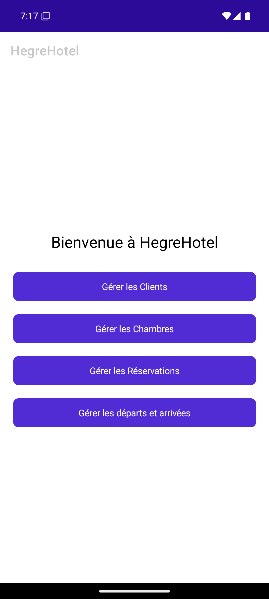
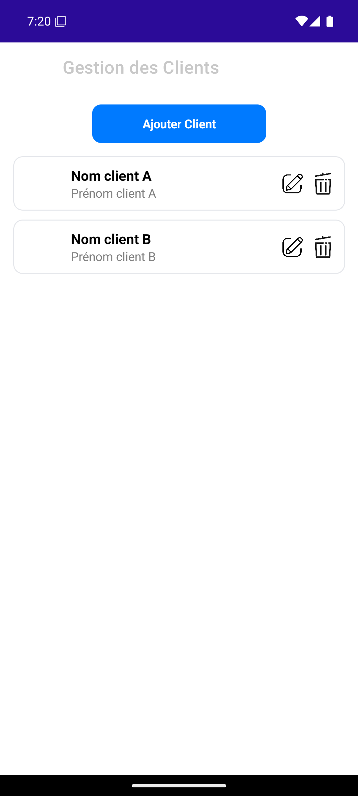
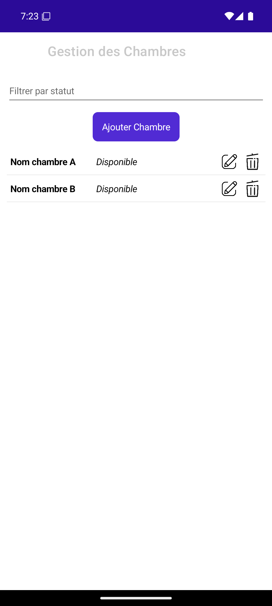
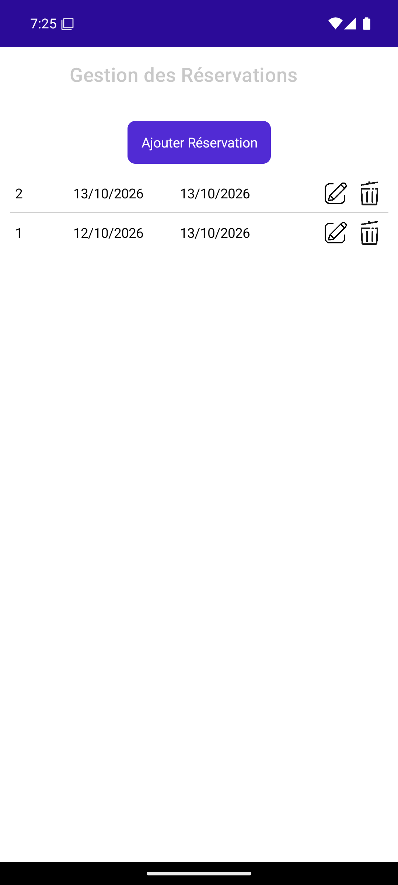
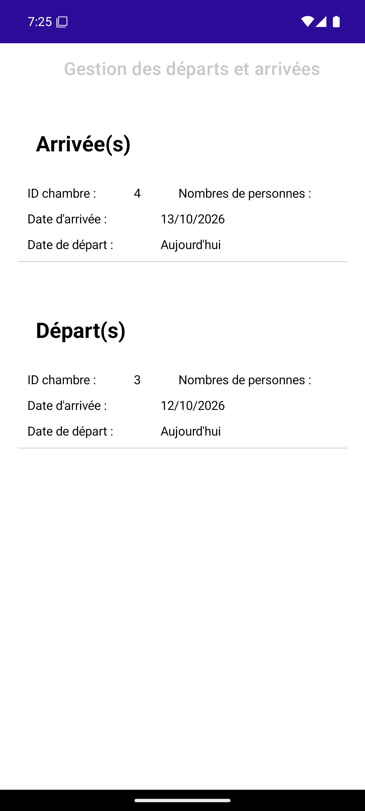

# Hotel Management Application

A mobile application developed with **C# and .NET MAUI 8**, designed to help hotel receptionists manage guests, rooms, reservations, and daily operations.

Originally developed as a collaborative academic project during the **BTS SIO SLAM** program, this application provides a centralized interface for hotel management.

## Platform Compatibility

HegreHotel is built with .NET MAUI and is configured to target Android, iOS, Mac Catalyst, and Windows.

**Tested platform:** Android (Android emulator, .NET 8).

Compatibility with iOS, Mac Catalyst, and Windows has not yet been verified.

## Features

### Guest Management

- Create, view, update, and delete guest records.
- Access guest information and reservation history.
- View previous stays and cancelled reservations.

### Room Management

- Create, view, update, and delete rooms.
- Manage room availability and occupancy.
- Block and unblock rooms.

### Reservation Management

- Create and modify reservations.
- Manage reservation dates and guest counts.
- Record special requests.
- View and manage existing reservations.

### Availability & Scheduling

- View available and occupied rooms.
- Filter room availability by date range.
- Access reservation information.

## Screenshots

Explore the main features of HegreHotel through its Android interface.

| Home | Customers | Rooms |
|:---:|:---:|:---:|
|  |  |  |

| Reservations | Check-in & Check-out |
|:---:|:---:|
|  |  |

## Tech Stack

| Category                | Technologies   |
| ----------------------- | -------------- |
| Language                | C#             |
| Framework               | .NET MAUI 8    |
| User Interface          | XAML           |
| Database                | SQLite         |
| Database Library        | sqlite-net-pcl |
| Target Platform         | Android        |
| Development Environment | Visual Studio  |

## Getting Started

### Prerequisites

- .NET 8 SDK
- Visual Studio with .NET MAUI development tools
- Android SDK
- Android emulator or compatible physical device

### Installation

**1. Clone the repository**

```bash
git clone git@github.com:Maxiser00/hotel-management-app.git
cd hotel-management-app
```

**2. Open the solution**

Open `HegreHotel.sln` in Visual Studio.

**3. Restore dependencies**

```bash
dotnet restore
```

**4. Select the target platform**

Choose an Android emulator or connect a compatible Android device.

**5. Run the application**

Press `F5` in Visual Studio or use the Run button.

The application initializes its SQLite database and creates the required tables during startup.

## Database

The application uses a local SQLite database through `sqlite-net-pcl`.

The following tables are initialized:

- `Client`
- `Reservation`
- `Chambre`
- `Status`

Default room statuses include:

- Available
- Occupied
- Unavailable

## Screenshots

Screenshots of the application interface will be added later.

## Project Background

Developed as a collaborative academic project during the **BTS Services Informatiques aux Organisations (SIO), option Solutions Logicielles et Applications Métier (SLAM)**.

The project provided practical experience in:

- Mobile application development with .NET MAUI
- C# programming and XAML interfaces
- Local data persistence with SQLite
- Guest, room, and reservation management
- Collaborative software development

## Contributors

This application was developed collaboratively by five contributors.

The repository is maintained by **[Maxiser00](https://github.com/Maxiser00)** as a portfolio presentation of the academic project.

The original development history is preserved separately. The new Git history does not represent the original distribution of contributions.

## Project Status

**Academic project — development completed.**

The application is preserved for portfolio purposes and may receive maintenance, documentation updates, and technical improvements.

## License

No open-source license is currently granted.

The project was developed collaboratively. Publication, distribution, and reuse of its source code remain subject to the rights of its contributors.
